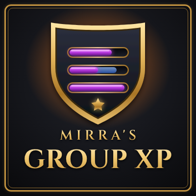

<p align="center">
  
</p>

# Mirra's Group XP

**Leveling is better with friends.** A World of Warcraft addon for **WoW Forever** that shows real-time XP bars for your whole party, announces level-ups and answers handy `!xp`, `!roll` and `!count` chat commands.

It is a complete rework of the classic *Group XP* addon for the WoW Forever client (Interface 16001).

## Features

- Rounded XP bars for every party member (and optionally yourself) with class-colored names, level, percent and `current / max` XP
- Rested XP shown as an overlay
- Customizable colors for the XP fill, rested XP, border and background (with opacity)
- Live XP sync between group members who use the addon
- Falls back to `!xp` replies in group chat for members without the addon
- XP line on party member tooltips
- Level-up announcement in group chat with a custom message (`[level]` placeholder)
- Settings panel under **Options → AddOns**
- Move the bars with **Ctrl + drag**

## Installation

1. Download the latest release (or this repository).
2. Put the addon files into a folder named `MirrasGroupXP` inside the `Interface\AddOns` folder of your WoW Forever installation:

   ```
   <WoW Forever folder>\Interface\AddOns\MirrasGroupXP\MirrasGroupXP.toc
   ```

   The folder name must be exactly `MirrasGroupXP`.
3. Start the game (or `/reload`) and enable the addon in the AddOns list.

## Slash commands

`/mgxp` (aliases: `/groupxp`, `/gxp`)

| Command | Description |
| --- | --- |
| `/mgxp` | Open the settings panel |
| `/mgxp test` | Toggle test bars |
| `/mgxp show` / `/mgxp hide` | Show or hide the bars |
| `/mgxp request` | Ask your group for their XP |
| `/mgxp status` | Show the sync status of your group |
| `/mgxp debug` | Toggle sync debug messages |
| `/mgxp reset` | Reset all settings |
| `/mgxp help` | List all commands |

## Chat commands

When *Answer chat commands* is enabled, the addon replies to these messages in party and instance chat. `!xp` and `!count` also work via whisper and Battle.net whisper.

| Command | Description |
| --- | --- |
| `!xp` | Replies with your level and current experience |
| `!count <item>` | Replies with how many of the item you carry, e.g. `!count Linen Cloth` |
| `!roll` | Rolls 1–100 |
| `!roll 50` | Rolls 1–50 |
| `!roll 10 50` / `!roll 10-50` | Rolls 10–50 |

## Settings

- Show XP bars, include my own XP, show rested XP
- XP on party tooltips, answer chat commands, announce level-ups (with custom message)
- Bar width, height, scale and spacing
- Colors: experience, rested XP, border and background, each with opacity, plus a *Reset colors* button
- Toggle test bars, reset position, reset all settings

## Credits

Based on *Group XP* by Clamchowder and Kekshaus.
